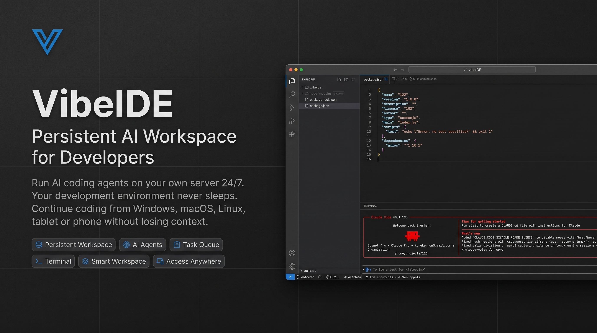

# VibeIDE

VibeIDE is a persistent browser IDE for remote vibe-coding workspaces. It is designed to run on a VDS 24/7: open it from a laptop, phone, or tablet, manage projects, edit files, use Git, keep terminal sessions alive while the backend is running, and send tasks to CLI-based AI agents.

The app combines a Vue/Monaco frontend with a Fastify backend, project-scoped filesystem APIs, WebSocket terminals, Git tools, and a lightweight file-backed AI agent task queue. No database, Redis, or PostgreSQL is required.

## Features

- Browser IDE with Monaco Editor, file explorer, workspace notes, tabs, Git panel, terminal panel, and mobile/PWA support.
- Project manager where every folder inside `workspace` is treated as a separate project.
- Lazy workspace loading so large folders like `node_modules`, `.venv`, `target`, and `build` do not freeze the UI.
- `.vibeignore` plus default ignored folders, with `Open Anyway` for manual inspection.
- WebSocket terminals scoped to the current project.
- Git status/diff scoped only to the project root, with optional `Initialize repository`.
- Codex CLI and Claude Code CLI with a persistent, sequential project task queue.
- Ollama and OpenAI-compatible model APIs configured through Settings.
- Chronos MCP task import, status sync and Telegram progress notifications.
- Daily CLI checks with a selected time, timezone and agent.
- Local Monaco assets and Docker Compose with persistent storage.
- Persistent file-backed task queue and logs under `.vibeide/agents`.
- Telegram notifications for agent task events.
- Compact Project Runtime Dashboard and Workspace Health widgets.
- Login protection, safe path checks, file size limits, binary-file protection, and workspace-only execution.

## One-Command Install

Linux/macOS:

```bash
curl -fsSL https://raw.githubusercontent.com/kantaevsherhan/vibe-ide/main/scripts/install.sh | bash
```

Windows PowerShell:

```powershell
irm https://raw.githubusercontent.com/kantaevsherhan/vibe-ide/main/scripts/install.ps1 | iex
```

Custom Linux/macOS install:

```bash
curl -fsSL https://raw.githubusercontent.com/kantaevsherhan/vibe-ide/main/scripts/install.sh \
  | env VIBEIDE_INSTALL_DIR=/opt/vibe-ide VIBEIDE_PORT=9090 VIBEIDE_WORKSPACE_DIR=/home/projects bash
```

Custom Windows install:

```powershell
irm https://raw.githubusercontent.com/kantaevsherhan/vibe-ide/main/scripts/install.ps1 | iex
# or after downloading:
.\scripts\install.ps1 -InstallDir C:\vibe-ide -Port 9090 -WorkspaceDir C:\projects
```

The installer clones or updates the repository, installs dependencies, builds frontend and backend, writes config files, starts VibeIDE in the background, and prints the URL.
It also enables autostart:

- Linux: systemd user service, with `crontab @reboot` fallback.
- macOS: LaunchAgent.
- Windows: Scheduled Task on user logon with restart-on-failure settings.

Disable autostart when needed:

```bash
curl -fsSL https://raw.githubusercontent.com/kantaevsherhan/vibe-ide/main/scripts/install.sh | env VIBEIDE_AUTOSTART=0 bash
```

```powershell
.\scripts\install.ps1 -NoAutostart
```

Default values:

```txt
Install dir: ~/vibe-ide on Linux/macOS, %USERPROFILE%\vibe-ide on Windows
URL: http://127.0.0.1:8080
Workspace: <install-dir>/workspace
Login: admin / change-me
```

Stop background process:

```bash
~/vibe-ide/scripts/stop.sh
```

```powershell
& "$env:USERPROFILE\vibe-ide\scripts\stop.ps1"
```

## Build and Start

For manual production startup:

```bash
npm install
npm run build
npm start
```

Open:

```txt
http://127.0.0.1:8080
```

Do not open `apps/frontend/dist/index.html` directly as a file. The built frontend must be served by the backend so API routes, auth cookies, and WebSocket terminals work.

## Icons

The source logo is stored at:

```txt
apps/frontend/public/logo.png
```

Generated browser and PWA icons live in `apps/frontend/public`:

```txt
favicon.ico
favicon-16x16.png
favicon-32x32.png
favicon-48x48.png
apple-touch-icon.png
android-chrome-192x192.png
android-chrome-512x512.png
mstile-150x150.png
manifest.webmanifest
```

Extra desktop packaging PNG files are stored in:

```txt
apps/frontend/public/icons/linux/
apps/frontend/public/icons/macos/
```

To replace the project logo, replace `apps/frontend/public/logo.png`, regenerate the icon sizes from it, and keep `manifest.webmanifest` pointed at the Android/PWA icon files.

## Mobile Browser

Open VibeIDE in a mobile browser or install it from the browser as a PWA.

## Manual Update

After logging in, open the Projects page and click `Check for Updates`. VibeIDE starts a background update job, shows live logs, and keeps the HTTP request short.

The update job uses a fixed backend pipeline:

```txt
git fetch origin
compare HEAD with origin/main
git pull --ff-only origin main
npm install
npm run build
```

Logs are stored in:

```txt
.vibeide/system/update/<job-id>.log
```

Runtime is detected automatically when possible. You can also configure it in:

```txt
config/runtime.json
```

Example:

```json
{
  "runtime": "systemd",
  "service": "vibeide"
}
```

Supported runtime values:

```txt
manual
systemd
pm2
docker
```

Restart behavior:

- `manual`: update finishes and asks you to restart VibeIDE manually.
- `pm2`: VibeIDE schedules `pm2 restart <processName>`.
- `systemd`: VibeIDE schedules `systemctl restart <service>`.
- `docker` uses host-side image rebuilding through Docker Compose.

Local generated files such as `.vibeide/`, `logs/`, `data/`, `storage/`, `config/settings.json`, and `config/runtime.json` do not block updates. Local source code changes still block the safe default update mode.

Manual restart examples:

```bash
sudo systemctl restart vibeide
pm2 restart vibeide
```

For manual starts, stop the current process with `Ctrl+C` and run:

```bash
npm run start
```

## Docker

Copy `.env.example` to `.env`, set a unique `VIBEIDE_PASSWORD` and a `VIBEIDE_SESSION_SECRET` containing at least 32 characters, then start the service.

```bash
docker compose up -d --build
docker compose ps
```

Open `http://127.0.0.1:8080` and sign in as `admin` with the configured password. Compose binds to localhost. To use a host project directory, set `VIBEIDE_WORKSPACE` to an absolute directory path in `.env`. The node container user needs write access to that directory.

Named volumes persist the workspace, configuration and CLI home. Healthchecks monitor the backend, and the service restarts after crashes or Docker startup. Run one backend per workspace.

To include CLI tools, set `VIBEIDE_CLI_PACKAGES` to space-separated npm package specifications such as `@openai/codex @anthropic-ai/claude-code` before building. Pin package versions for repeatable deployments. Authenticate the installed CLIs inside the container.

Use the Codex Compose override to allow its nested sandbox when running Codex in Docker.

```bash
docker compose -f compose.yaml -f compose.codex.yaml up -d --build
```

```bash
docker compose exec vibe-ide codex login --device-auth
docker compose exec vibe-ide claude auth login
```

API-only and Ollama configurations work with the default image. Linux hosts can set the Ollama URL to a reachable host address.

Update containers from the host checkout.

```bash
git pull --ff-only
docker compose up -d --build
```

The in-app updater returns container rebuild instructions. Configuration files and the workspace are kept in persistent volumes.

## Security

VibeIDE is protected by credentials from:

```txt
config/vibeide.config.json
```

Change these values before exposing the app:

```json
{
  "auth": {
    "username": "admin",
    "password": "change-me",
    "sessionSecret": "change-this-secret"
  }
}
```

Do not keep `change-me` in production. Anyone with that password can read and edit workspace files and open a terminal inside the workspace. Also replace `sessionSecret` with a long random value so session cookies cannot be guessed.

Change host, port, and workspace in the same file:

```json
{
  "server": {
    "host": "0.0.0.0",
    "port": 8080
  },
  "workspace": {
    "path": "/workspace",
    "maxFolderChildren": 500
  }
}
```

Feature flags and file limits:

```json
{
  "security": {
    "allowTerminal": true,
    "allowGit": true,
    "maxFileSizeMb": 5,
    "allowedOrigins": ["https://ide.example.com"]
  }
}
```

For production behind Nginx, terminate HTTPS at Nginx and proxy to VibeIDE on localhost. Use a concrete domain in `allowedOrigins`; `["*"]` is intended only for development.

## Projects

VibeIDE treats every folder inside `workspace` as a separate project:

```txt
workspace/
├── my-react-app/
├── backend-api/
└── landing-page/
```

After login, VibeIDE opens `/projects`. From there you can create, open, and delete projects. Project metadata is stored at:

```txt
workspace/<project>/.vibeide/project.json
```

Inside the IDE, file operations, Git commands, terminals, and AI agents are scoped to that project folder only.

VibeIDE also creates a project-local `.vibeide/.gitignore`:

```txt
agents/
sessions/
logs/
tasks.json
state.json
```

This keeps AI logs, task queues, temporary sessions, and runtime state out of Git while allowing project documentation to be committed.

## File Explorer

VibeIDE does not scan the whole project at once. It loads only one folder level at a time:

```txt
GET /api/files/children?projectName=my-project&path=src
```

Ignored folders remain visible but muted. Defaults include:

```txt
node_modules, dist, build, target, .next, .nuxt, .venv, vendor, .git
```

Project-specific ignore rules live in:

```txt
workspace/<project>/.vibeignore
```

Use `Open Anyway` to inspect an ignored folder one level at a time:

```txt
GET /api/files/children?projectName=my-project&path=node_modules&force=true
```

Large folders are capped by `workspace.maxFolderChildren`. Large files and binary files are protected from accidental Monaco preview.

## Workspace Notes

Workspace Notes is a small Obsidian-like Markdown tree inside each project. Notes are stored next to the project metadata:

```txt
workspace/<project>/.vibeide/notes/
```

The Notes activity view behaves like the file explorer: folders are loaded lazily, can be expanded and collapsed, and support creating Markdown files, folders, rename, delete, duplicate, copy path, and drag-and-drop moves.

Opening a note uses the same editor tab system as source files. Markdown notes autosave after edits and support `Edit`, `Preview`, and `Split` modes with rendered tables, task lists, code blocks, links, images, blockquotes, horizontal rules, emoji, and syntax highlighting.

Notes live inside `.vibeide` because they belong to VibeIDE's project workspace, but they are intentionally not ignored. Markdown files under `.vibeide/notes` should be indexed by Git so architecture notes, TODOs, prompts, and project documentation travel with the repository. Only runtime files listed in `.vibeide/.gitignore` are excluded.

## Git

Git commands run only inside the selected project. VibeIDE does not read parent repositories. If `.git` is not present directly in the project root, the Git panel shows that the project is not a Git repository and offers `Initialize repository`.

Git API:

```txt
GET  /api/git/status?projectName=
POST /api/git/init
GET  /api/git/diff?projectName=&path=
```

## Terminals

Terminals run through WebSocket and `node-pty` with `cwd` set to:

```txt
workspace/<project>
```

Active terminals and their buffered output are kept in backend memory while the backend process is running. After backend restart, active terminals are reset.

## Settings

VibeIDE has two settings layers.

Local settings are stored in browser `localStorage` and are unique for each device:

- Theme: `Dark` or `Light`.
- Editor font size.
- Editor font family.

Server settings are stored in:

```txt
config/settings.json
```

They are shared for every device that opens the same VibeIDE server:

- AI agent command, arguments, and enabled state.
- Model API connections, Chronos and daily CLI checks.
- Telegram notification settings.
- Workspace information and future workspace options.

Open `Settings` from the Projects page or IDE activity bar. Agent and notification changes use auto save. Connections & timers has an explicit Save button.

Settings API:

```txt
GET  /api/settings
PUT  /api/settings
POST /api/settings/test-telegram
```

## AI Agents

The supported connections are Codex CLI, Claude Code CLI, Ollama and an OpenAI-compatible API. CLI processes run in the current project and stream stdout/stderr to the task log. Install and authenticate CLI tools in the backend environment.

Configure CLI paths, arguments and timeouts in Settings → Agents. Absolute executable paths are supported. The default Codex command is `codex exec --sandbox workspace-write`. Claude uses `claude -p`. Authentication or permission failures are visible in task logs.

Configure API model names, base URLs and keys in Settings → Connections & timers. API and Ollama connections return text suggestions in the task log. CLI agents handle project edits. API and Chronos keys are stored server-side and masked in settings responses. An empty key field retains the existing key for the same endpoint. Clearing the model disables that connection.

The API base URL must include the provider API prefix, for example `https://api.openai.com/v1` or `http://127.0.0.1:11434/v1`. From Docker Desktop, use `http://host.docker.internal:11434/v1` to reach Ollama running on the host.

The `VIBEIDE_API_MODEL`, `VIBEIDE_API_BASE_URL`, `VIBEIDE_API_KEY`, `VIBEIDE_OLLAMA_MODEL`, `VIBEIDE_OLLAMA_BASE_URL` and `VIBEIDE_OLLAMA_KEY` environment variables provide initial defaults. Saved UI settings take precedence.

## Chronos

In Chronos, create a write-scoped agent token. In VibeIDE, open Settings → Connections & timers, enter the MCP URL and token, select a workspace project and CLI agent, enable background checks, and save.

The deployed Chronos MCP endpoint is `https://chronos-beta-lyart.vercel.app/api/mcp`. Tasks are eligible when their title contains `[vibe]`, their Chronos project exactly matches the selected project folder, and they are still open. For example, a task named `[vibe] Fix login validation` with project `my-app` runs in `workspace/my-app`.

VibeIDE checks every minute and imports each task ID once. The source link is persisted in the project queue across restarts. Task status is written to the Chronos `data.vibeide` field with an updatedAt version check. A successful process produces the `review` state. Review the diff and tests before completing the task in Chronos. Use the existing queue Retry action for failed work.

Enable and test Telegram under Settings → Notifications. Messages include task start, finish, failure and the original Chronos title. Token expiry and connection errors are shown under Connections & timers. Use Check saved automation after saving connection changes.

## Daily CLI Schedule

Under Settings → Connections & timers choose a project, local time, IANA timezone and Codex CLI and/or Claude Code CLI. Save the settings. The initial time is 04:30 in Asia/Qyzylorda, and both agents start unchecked. Each selected agent receives one short request per local day. Clear both checkboxes and save to disable it.

VibeIDE must be running at the scheduled minute. Missed times are skipped, and an existing project queue can delay the request. The request uses read-only Codex mode or disabled Claude tools. Provider rules determine usage windows and quota restoration.

Official protocol documentation is available for [Chat Completions](https://developers.openai.com/api/reference/resources/chat/subresources/completions/methods/create), [Ollama compatibility](https://docs.ollama.com/api/openai-compatibility), [Claude CLI flags](https://code.claude.com/docs/en/cli-reference) and [MCP transport](https://modelcontextprotocol.io/specification/2025-03-26/basic/transports).

## Task Queue

Agent state is stored inside each project:

```txt
workspace/<project>/.vibeide/
├── context.md
├── agents/
│   ├── tasks.json
│   ├── sessions.json
│   └── logs/
│       └── <task-id>.log
└── state.json
```

When a task is created, VibeIDE reads `.vibeide/context.md`, adds it to the prompt, and sends the final prompt to the selected CLI agent. Queued tasks and task history are persisted in `tasks.json`; logs are appended to `logs/<task-id>.log`.

If the backend restarts, active agent processes are not restored, but persisted tasks and history remain available. Tasks that were `running` or `waiting` are marked with an error and can be retried from the Agents panel.

Agent API:

```txt
GET    /api/agents
GET    /api/agents/status?projectName=
GET    /api/agents/tasks?projectName=
POST   /api/agents/tasks
POST   /api/agents/tasks/:taskId/cancel
POST   /api/agents/tasks/:taskId/retry
POST   /api/agents/tasks/:taskId/move
GET    /api/agents/tasks/:taskId/log
```

Live output is streamed through:

```txt
/ws/agents?projectName=
```

## Telegram Notifications

Telegram notifications are optional and disabled by default in `config/settings.json`.

When enabled, VibeIDE sends notifications for agent task completion, errors, waiting state, and stopped tasks. Notification failures do not break agent execution.

## Workspace Health

The IDE header includes compact workspace health:

```txt
Git: 4 changed
Terminals: 2 active
Agents: 1 running
```

Backend endpoint:

```txt
GET /api/workspace/health?projectName=my-project
```

Workspace Health intentionally reports only Git, terminal, and AI agent state. It does not include CPU/RAM, Docker, frontend status, API status, databases, Redis, or test reports.

## API Protection

All project APIs require a valid session cookie:

```txt
/api/projects/*
/api/files/*
/api/git/*
/api/agents/*
/api/workspace/*
/api/terminal/*
/api/terminals
/ws/terminal
/ws/agents
```

All paths are constrained to `workspace/<project>` through safe path checks.
